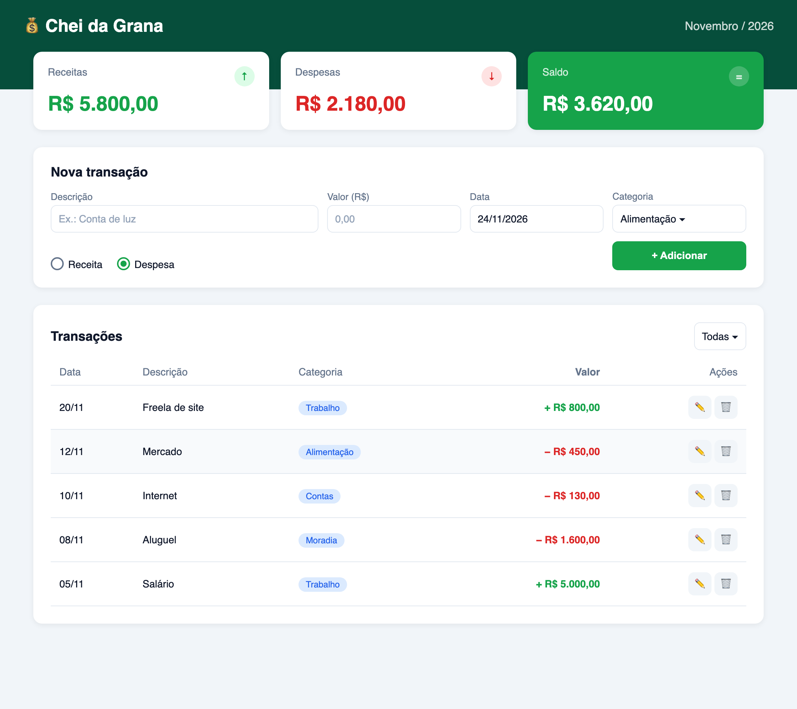
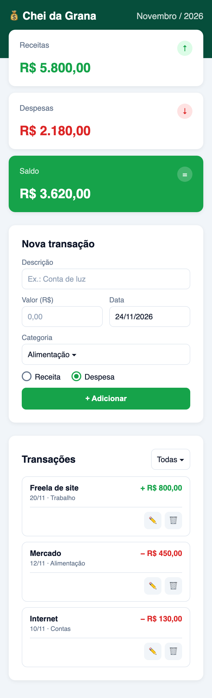

# 💰 Chei da Grana

Desafio para praticar **HTML, CSS e JavaScript** construindo, em dupla, uma tela de controle financeiro pessoal.

## 👀 Preview

Assim deve ficar a tela. Clique numa imagem para abrir em tamanho real.

<table>
  <tr>
    <th>🖥️ Web</th>
    <th>📱 Mobile</th>
  </tr>
  <tr>
    <td valign="top"><a href="docs/layout-desktop.png"></a></td>
    <td valign="top"><a href="docs/layout-mobile.png"></a></td>
  </tr>
</table>

📎 Arquivos de referência: [layout web](docs/layout-desktop.png) · [layout mobile](docs/layout-mobile.png)

> O layout é a referência. Não precisa ficar idêntico ao pixel, mas a estrutura (header, cards, formulário, tabela) deve ser a mesma. No celular os cards ficam empilhados e a tabela vira uma lista.

Vocês vão criar uma página onde dá para **cadastrar receitas e despesas**, ver tudo numa tabela, **editar**, **excluir** e acompanhar um **resumo** que se recalcula sozinho. Ou seja: um CRUD completo.

---

## 🤖 Regra: IA só para consulta

Neste desafio a IA (ChatGPT, Claude, Gemini, Copilot etc.) pode ser usada **apenas como consulta**, do mesmo jeito que vocês usariam a documentação ou perguntariam a um professor. **O código quem escreve são vocês.**

✅ **Pode:**

- Perguntar o que é um conceito: _"o que o `addEventListener` faz?"_, _"qual a diferença entre `let` e `const`?"_
- Pedir para explicar uma mensagem de erro
- Pedir para explicar um trecho de código que **vocês** escreveram e não entenderam por que funciona (ou não)

❌ **Não pode:**

- Pedir para a IA escrever o código (nem "só essa função")
- Colar este README ou partes do projeto e pedir a solução
- Copiar e colar código gerado por IA
- Usar autocompletar de IA no editor (Copilot, Cursor Tab, Codeium etc.). Desliguem durante o desafio

> **Regra de ouro:** se você não consegue explicar uma linha do seu código, ela não deveria estar lá. Na revisão do Pull Request, o colega pode pedir para explicar qualquer linha.

---

## 📋 Requisitos

### HTML (estrutura)

- [ ] Usar tags semânticas: `header`, `main`, `section`, `form`, `table`
- [ ] Todo campo do formulário tem um `<label>`
- [ ] Usar os campos nativos do navegador: `type="number"`, `type="date"`, `<select>` e `type="radio"`
- [ ] Campos obrigatórios com `required` (o navegador já valida para vocês)

### CSS (visual)

- [ ] Cores definidas como **variáveis** em `:root` (ex.: `--cor-receita`, `--cor-despesa`)
- [ ] Cards de resumo lado a lado usando **Flexbox** ou **Grid**
- [ ] Layout **responsivo** com pelo menos 1 `@media` query (no celular os cards ficam empilhados)
- [ ] Efeito `:hover` nos botões e nas linhas da tabela
- [ ] Valor de receita em verde, despesa em vermelho, e o **saldo fica vermelho quando negativo**

### JavaScript (lógica e CRUD)

| Operação   | O que deve acontecer |
|------------|----------------------|
| **Create** | Enviar o formulário adiciona uma transação na lista |
| **Read**   | A tabela mostra todas as transações, da mais recente para a mais antiga |
| **Update** | Clicar em ✏️ coloca os dados de volta no formulário e o botão muda para **"Salvar"** |
| **Delete** | Clicar em 🗑️ pede confirmação (`confirm()`) e remove a transação |

Além do CRUD:

- [ ] **Resumo:** qualquer alteração recalcula o total de receitas, o total de despesas e o saldo
- [ ] **Persistência:** salvar os dados no `localStorage`. Ao recarregar a página nada pode sumir
- [ ] **Formatação:** valores em reais, por exemplo `R$ 1.500,00`
  (dica: `toLocaleString('pt-BR', { style: 'currency', currency: 'BRL' })`)
- [ ] **Validação:** não aceitar descrição vazia nem valor zero ou negativo

### Modelo de dados sugerido

Cada transação pode ser um objeto assim:

```js
{
  id: 1732450000000,        // Date.now() serve como id
  descricao: "Salário",
  valor: 5000,              // sempre positivo; quem diz se soma ou subtrai é o "tipo"
  tipo: "receita",          // "receita" ou "despesa"
  categoria: "Trabalho",
  data: "2026-11-05"
}
```

E todas as transações ficam num array.

---

## 🤝 Como trabalhar em dupla

1. **Juntos:** leiam este README, olhem o layout e combinem os nomes das classes CSS e o modelo de dados.
2. **Divisão:** um começa pelo **HTML + CSS** e o outro pela **lógica em JS** (dá para testar com um HTML provisório).
3. **Troca:** quem fez o CSS implementa o **Update**, e quem fez o JS implementa o **responsivo**. Assim os dois praticam tudo.
4. **Git:** cada um trabalha na sua branch, abre um Pull Request e o outro revisa antes do merge. Façam commits pequenos e frequentes.

### Estrutura sugerida de arquivos

```
chei-da-grana/
├── index.html
├── style.css
└── script.js
```

---

## ✅ Checklist de entrega

- [ ] Adicionar, editar e excluir funcionando
- [ ] O resumo bate com a soma da tabela
- [ ] Recarregar a página mantém os dados
- [ ] Não aceita valor vazio, zero ou negativo
- [ ] Fica bom no celular (testem no DevTools: F12, depois o ícone de celular)
- [ ] Nenhum erro no console (F12, aba Console)
- [ ] Publicado no **GitHub Pages** para mostrar para os amigos 😎

---

## 🚀 Bônus (para quem terminar antes)

- [ ] Filtro por tipo (todas, receitas ou despesas)
- [ ] Filtro por mês
- [ ] Total gasto por categoria
- [ ] Gráfico de barras feito **só com CSS** (barras com `width` em %)
- [ ] Botão de modo escuro

---

## 💡 Dicas

- Quando travarem, perguntem-se:
  1. **Onde fica o dado?** (no array)
  2. **Quando a tela precisa atualizar?** (sempre que o array mudar)
  3. **Qual função faz isso?**
- Uma única função `render()` que **apaga e redesenha** a tabela e o resumo a partir do array resolve metade dos problemas.
- O `localStorage` só guarda texto: pesquisem `JSON.stringify` e `JSON.parse`.
- Para buscar ajuda use a [MDN](https://developer.mozilla.org/pt-BR/). É a melhor referência de HTML, CSS e JS.

Bom código! 💚
